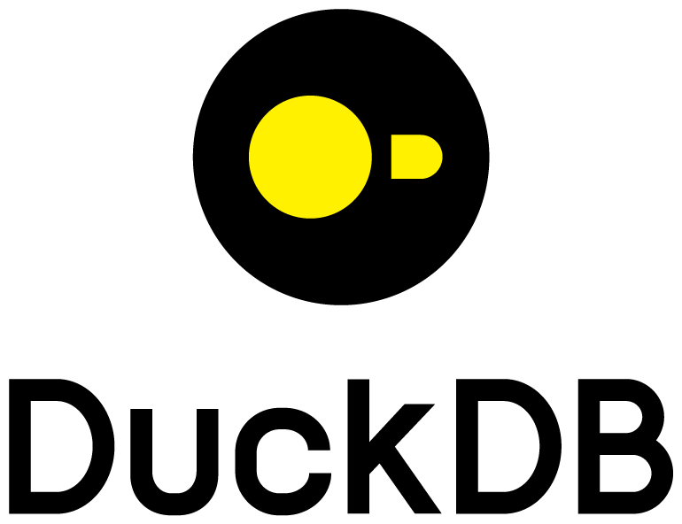
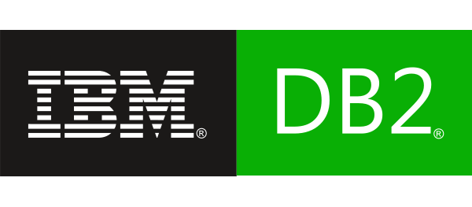

<!--
Licensed to the Apache Software Foundation (ASF) under one
or more contributor license agreements.  See the NOTICE file
distributed with this work for additional information
regarding copyright ownership.  The ASF licenses this file
to you under the Apache License, Version 2.0 (the
"License"); you may not use this file except in compliance
with the License.  You may obtain a copy of the License at

  http://www.apache.org/licenses/LICENSE-2.0

Unless required by applicable law or agreed to in writing,
software distributed under the License is distributed on an
"AS IS" BASIS, WITHOUT WARRANTIES OR CONDITIONS OF ANY
KIND, either express or implied.  See the License for the
specific language governing permissions and limitations
under the License.
-->

# Asset approval — QA build

Apache Superset with **maker-checker review** turned on: an edit to a
dashboard, chart or dataset does not reach viewers until a second eligible
editor approves it.

This branch exists for testing that feature and nothing else. It is not
proposed for merge, and the parts of it that belong in Superset go upstream
as their own pull requests. Superset's own README follows this guide.

---

## Setting it up

You need Docker with roughly 8 GB available to it. Everything below runs
from the root of this checkout. The first run takes 15–25 minutes, nearly
all of it image building and example loading.

### 1. Build the extension

The review feature ships as a Superset extension. Its source is in the
repository; its build output is not, so you build it once:

```bash
docker run --rm -v "$PWD:/app" -w /app/local_extensions/asset-approval/frontend node:20 bash -lc "npm install --legacy-peer-deps && npm run build"
```

`--legacy-peer-deps` is required, not optional: the published
`@apache-superset/core` still declares a peer dependency on React 17 while
Superset itself is on React 18, so a plain `npm install` refuses to resolve.

Then assemble the loadable bundle:

```bash
docker run --rm -v "$PWD:/app" -w /app/local_extensions/asset-approval node:20 bash -lc "bash build.sh"
```

That writes `local_extensions/asset-approval/dist/`. It worked if it prints
`built: 19 files` and the manifest lists two contributed pages.

### 2. Start Superset

```bash
NODE_PORT=9002 docker compose -p asset-approval-qa -f docker-compose-light.yml up -d
```

The first run builds images and loads the example dashboards, which is the
slow part. Follow it with:

```bash
docker compose -p asset-approval-qa logs -f superset-init-light
```

When that container exits, open **http://localhost:9002** and sign in as
`admin` / `admin`.

The example dashboards load on the first run, which is what the seed in the
next step edits. If `docker/.env-local` exists on your machine and sets
`SUPERSET_LOAD_EXAMPLES=no`, it wins over the default and they are skipped —
the init log then shows three steps instead of four. Load them by hand with:

```bash
docker compose -p asset-approval-qa exec superset-light /app/.venv/bin/superset load-examples
```

### 3. Seed the review flow

```bash
docker compose -p asset-approval-qa exec superset-light /app/.venv/bin/python /app/local_extensions/asset-approval/qa/seed.py
```

This creates the two test accounts, makes them both editors of an example
dashboard, chart and dataset, and leaves exactly one change waiting for a
reviewer. It prints what it set up, and it is safe to re-run at any time.

---

## Logins

Every account below is a local QA fixture created by `qa/seed.py` (or by
Superset's own init, for `admin`). None of these passwords are used anywhere
real.

| user | password | role | editor of | use it for |
|---|---|---|---|---|
| `maker` | `general` | Alpha | USA Births Names, the first chart, the first dataset, Sales Dashboard (sole editor) | making changes |
| `checker` | `general` | Alpha | USA Births Names, the first chart, the first dataset | reviewing them |
| `viewer` | `general` | Gamma + "Viewer (data access)" | nothing | seeing what everyone else sees |
| `admin` | `admin` | Admin | nothing | setup, and checking there is no admin bypass |

The seeded assets, all from `superset load-examples`:

| asset | editors | what it is for |
|---|---|---|
| **USA Births Names** (dashboard) | maker, checker | the main walkthrough: a change here can be approved |
| **Sales Dashboard** (dashboard) | maker only | the state where nobody else can approve |
| first chart by id (**Deck.gl Grid** on a fresh load) | maker, checker | the chart walkthrough |
| first dataset by id (**bart_lines** on a fresh load) | maker, checker | the dataset walkthrough |

**Test as `maker`, `checker` and `viewer`, not as `admin`.** Admin's blanket
access deliberately does not count as editorship for approval, so admin sees
a more permissive picture than a real user does. Permission and UI bugs only
show up on the non-admin accounts.

Two editor accounts exist because an author may never approve their own
work: the gate looks for a *second* editor of the asset, so one account
cannot demonstrate the flow at all. `viewer` is deliberately an editor of
nothing: while a change sits in review its bell has no count, it has nothing
in Approvals, and it sees the asset exactly as it was.

Use one browser profile (or a private window) per account, so you can switch
between them without signing out each time.

---

## The happy flow, step by step

Run `qa/seed.py` first (see [Starting over](#starting-over)). It leaves one
change already waiting: `maker` renamed **USA Births Names** to
"USA Births Names (Q4)" and asked for review. Steps 1–3 look at that change
from each side; step 4 onwards walks a full round yourself. Each step says
what you should see; anything else is a finding.

### A. A change waits for review

1. **As `viewer`** — open **USA Births Names**.
   - The title is still "USA Births Names". No banner, no badge, and the bell has no count.
   - Settings has no Approvals entry for you. Opening `/approvals/` directly says "Nothing needs you right now".
2. **As `admin`** — open **USA Births Names**.
   - No review banner and no Approve button. Admin is not an editor, and there is no admin bypass.
3. **As `checker`** — find the change.
   - The bell shows **1**; its popover lists USA Births Names under "Needs your review".
   - Home → **Pending reviews** lists it.
   - **Settings → Manage → Approvals** (or the bell's "View all approvals") lists it as "Needs your review", with a **Review** button.

### B. Review it on the dashboard

4. **As `checker`** — click **Review**. It opens the dashboard itself.
   - A banner reads "Reviewing changes from Maker (QA) · N changes", with **Show changes**, **What changed** and **Open live version**.
   - The **Review changes** panel opens on its own, beside the charts. It shows the field diff (`dashboard_title`: old struck through, new in green), an "Add to the note" box, and **Request changes** / **Approve** pinned to its footer.
   - **Show changes** previews the dashboard as it would look approved.
5. **As `checker`** — press **Edit dashboard**.
   - A dialog says "Maker (QA) is changing this dashboard", with when it was saved and **View changes**. Only one change per asset can be open. Cancel.
6. **As `checker`** — **Request changes**, type a note, send.
7. **As `maker`** — open **USA Births Names**.
   - The banner says checker requested changes and shows the note.
   - The bell lists it under "Returned to you".

### C. Make and send a change yourself

8. **As `maker`** — **Edit dashboard**, change the title, **Save**.
   - The toast says "Changes saved. Viewers still see the live version."
   - The banner reads "Viewing your changes … viewers still see the live version", with **Show changes**, **What changed** and **Request review**.
   - Check as `viewer` in the other window: still the old title.
9. **As `maker`** — **Request review**.
   - The dialog shows "Who can approve: Checker (QA)", an optional "Ask someone specific" picker, and "Your changes lock while they wait. Editing withdraws the request."
   - Add a note and send. The banner turns to "Awaiting review … Checker (QA) can approve", and you are never offered an Approve button.

### D. Approve it

10. **As `checker`** — open the dashboard again (bell or Approvals) and press **Approve** in the panel.
    - It asks first: "Approve and publish? Viewers see these changes right away. The current version moves to version history."
    - Confirm. The banner disappears and the new title is live.
11. **As `viewer`** — reload. The new title is there now.
12. **As `checker`** — **⋯ → View version history**. The approval is the newest entry.

### E. Charts

13. **As `maker`** — open the seeded chart in Explore, change its name, **Save**.
    - The chart shows the "viewers still see the live version" banner. **Charts** lists it with a **Changes pending** tag. As `viewer`, the chart keeps its old name.
14. **As `maker`** — **Request review** from the chart's banner.
15. **As `checker`** — **Settings → Manage → Approvals → Review**, then Approve. The new name goes live.

### F. Datasets

16. **As `maker`** — **Datasets → edit** the seeded dataset, change something (for example a metric label on the Metrics tab), **Save**, **Confirm**.
    - The toast says the changes are saved and viewers still see the live version, with a **Review changes →** link.
17. **As `maker`** — follow **Review changes →**. It opens Approvals filtered to "Submitted by me".
    - The dataset row is a Draft with **Request review**. Send it. The row flips to "Awaiting review".
18. **As `checker`** — **Approvals → Review** on the dataset row.
    - The "Review dataset changes" dialog opens on the tab that changed (Source / Metrics / Columns).
    - It shows live struck through beside proposed in green, and how many charts and dashboards use the dataset.
    - **Approve**. The change goes live.

### G. Deletes wait too

19. **As `maker`** — delete the seeded chart from the **Charts** list and confirm.
    - The toast says the delete was submitted for review and nothing has been removed. The chart is still listed.
    - Approving it as `checker` removes it; request changes to keep it.

### H. When nobody else can approve

20. **As `maker`** — on **Sales Dashboard** (maker is its only editor), change the title, **Save**, **Request review**.
    - The dialog says "No one else can approve this dashboard. Add another editor to submit.", with an **Editors** picker and "Changing editors doesn't need approval."
21. **As `maker`** — add **Checker (QA)** in that picker.
    - The warning clears in place and the dialog switches to "Who can approve: Checker (QA)". Send.
    - Run the seed again afterwards to make maker the only editor again.

### I. The rules, from the outside

22. **As `admin`** — **Settings → Manage → Change review** opens a read-only page.
    - "Require review before changes go live" — "Set in the instance configuration. Changing it needs a restart."
    - The four facts below it, including **Admin bypass: Not available**.
23. **Any editor, through the API** — a direct save returns **202** with "Changes saved. Viewers still see the live version.", and the live object does not change:

        PUT /api/v1/dashboard/<id>   →   202 { "message": "Changes saved. Viewers still see the live version.", ... }

### J. Turning it off

With `CHANGE_MANAGEMENT` off (the default outside this branch), Superset behaves exactly as it does upstream: saves apply immediately, and there is no bell, banner or Approvals entry.

---

## Known gaps

Understood already — no need to file these:

- **No count on the Settings → Manage entry.** The design asks for the
  number to appear there as well as on the bell. Superset's menu entries
  carry no badge, so that needs a new capability rather than a placement
  change. The bell itself counts correctly.
- **No page per change request.** Review happens on the asset, or from the
  list for a dataset. Links that used to point at a change request's own
  page open the list instead.
- **Deleting a chart customization under review** clears the filter from
  your own view even though nothing was applied for anyone else. Superset
  clears those locally before the request goes out, and this branch does not
  reorder that.

## Reporting what you find

Say which account you were using, which numbered step you were on, and
whether the change was new or one the seed created. Where the UI and the
data disagree, the API is the tie-breaker:

    /api/v1/change_request/count          what the bell should show
    /api/v1/change_request/?show=for_me   what is waiting on you

## Starting over

Back to one change waiting for review, keeping everything else:

```bash
docker compose -p asset-approval-qa exec superset-light /app/.venv/bin/python /app/local_extensions/asset-approval/qa/seed.py
```

Back to nothing at all, database included:

```bash
docker compose -p asset-approval-qa -f docker-compose-light.yml down -v
```

---
---

*Everything below is Apache Superset's own README, unchanged.*

# Superset

[](https://opensource.org/license/apache-2-0)
[](https://github.com/apache/superset/releases/latest)
[](https://github.com/apache/superset/actions)
[](https://badge.fury.io/py/apache_superset)
[](https://pypi.python.org/pypi/apache_superset)
[](https://github.com/apache/superset/stargazers)
[](https://github.com/apache/superset/graphs/contributors)
[](https://github.com/apache/superset/commits/master)
[](https://github.com/apache/superset/issues)
[](https://github.com/apache/superset/pulls)
[](https://bit.ly/join-superset-slack)
[](https://superset.apache.org)
[](https://superset-storybook.netlify.app)
[](https://superset-bundle-analyzer.netlify.app)

<picture width="500">
  <source
    width="600"
    media="(prefers-color-scheme: dark)"
    src="https://superset.apache.org/img/superset-logo-horiz-dark.svg"
    alt="Superset logo (dark)"
  />
  
</picture>

A modern, enterprise-ready business intelligence web application.

### Documentation

- **[User Guide](https://superset.apache.org/user-docs/)** — For analysts and business users. Explore data, build charts, create dashboards, and connect databases.
- **[Administrator Guide](https://superset.apache.org/admin-docs/)** — Install, configure, and operate Superset. Covers security, scaling, and database drivers.
- **[Developer Guide](https://superset.apache.org/developer-docs/)** — Contribute to Superset or build on its REST API and extension framework.

[**Why Superset?**](#why-superset) |
[**Supported Databases**](#supported-databases) |
[**Release Notes**](https://github.com/apache/superset/releases) |
[**Get Involved**](#get-involved) |
[**Resources**](#resources) |
[**Organizations Using Superset**](https://superset.apache.org/inTheWild)

## Why Superset?

Superset is a modern data exploration and data visualization platform. Superset can replace or augment proprietary business intelligence tools for many teams. Superset integrates well with a variety of data sources.

Superset provides:

- A **no-code interface** for building charts quickly
- A powerful, web-based **SQL Editor** for advanced querying
- A **lightweight semantic layer** for quickly defining custom dimensions and metrics
- Out of the box support for **nearly any SQL** database or data engine
- A wide array of **beautiful visualizations** to showcase your data, ranging from simple bar charts to geospatial visualizations
- Lightweight, configurable **caching layer** to help ease database load
- Highly extensible **security roles and authentication** options
- An **API** for programmatic customization
- A **cloud-native architecture** designed from the ground up for scale

## Screenshots & Gifs

**Video Overview**

<!-- File hosted here https://github.com/apache/superset-site/raw/lfs/superset-video-4k.mp4 -->

[superset-video-1080p.webm](https://github.com/user-attachments/assets/b37388f7-a971-409c-96a7-90c4e31322e6)

<br/>

**Large Gallery of Visualizations**

<kbd></kbd><br/>

**Craft Beautiful, Dynamic Dashboards**

<kbd></kbd><br/>

**No-Code Chart Builder**

<kbd></kbd><br/>

**Powerful SQL Editor**

<kbd></kbd><br/>

## Supported Databases

Superset can query data from any SQL-speaking datastore or data engine (Presto, Trino, Athena, [and more](https://superset.apache.org/docs/databases)) that has a Python DB-API driver and a SQLAlchemy dialect.

Here are some of the major database solutions that are supported:

<!-- SUPPORTED_DATABASES_START -->
<p align="center">
  <a href="https://superset.apache.org/docs/databases/supported/amazon-athena" title="Amazon Athena"></a> &nbsp;
  <a href="https://superset.apache.org/docs/databases/supported/amazon-dynamodb" title="Amazon DynamoDB"></a> &nbsp;
  <a href="https://superset.apache.org/docs/databases/supported/amazon-redshift" title="Amazon Redshift"></a> &nbsp;
  <a href="https://superset.apache.org/docs/databases/supported/apache-doris" title="Apache Doris"></a> &nbsp;
  <a href="https://superset.apache.org/docs/databases/supported/apache-drill" title="Apache Drill"></a> &nbsp;
  <a href="https://superset.apache.org/docs/databases/supported/apache-druid" title="Apache Druid"></a> &nbsp;
  <a href="https://superset.apache.org/docs/databases/supported/apache-hive" title="Apache Hive"></a> &nbsp;
  <a href="https://superset.apache.org/docs/databases/supported/apache-impala" title="Apache Impala"></a> &nbsp;
  <a href="https://superset.apache.org/docs/databases/supported/apache-kylin" title="Apache Kylin"></a> &nbsp;
  <a href="https://superset.apache.org/docs/databases/supported/apache-pinot" title="Apache Pinot"></a> &nbsp;
  <a href="https://superset.apache.org/docs/databases/supported/apache-solr" title="Apache Solr"></a> &nbsp;
  <a href="https://superset.apache.org/docs/databases/supported/apache-spark-sql" title="Apache Spark SQL"></a> &nbsp;
  <a href="https://superset.apache.org/docs/databases/supported/ascend" title="Ascend"></a> &nbsp;
  <a href="https://superset.apache.org/docs/databases/supported/aurora-mysql-data-api" title="Aurora MySQL (Data API)"></a> &nbsp;
  <a href="https://superset.apache.org/docs/databases/supported/aurora-postgresql-data-api" title="Aurora PostgreSQL (Data API)"></a> &nbsp;
  <a href="https://superset.apache.org/docs/databases/supported/azure-data-explorer" title="Azure Data Explorer"></a> &nbsp;
  <a href="https://superset.apache.org/docs/databases/supported/azure-synapse" title="Azure Synapse"></a> &nbsp;
  <a href="https://superset.apache.org/docs/databases/supported/clickhouse" title="ClickHouse"></a> &nbsp;
  <a href="https://superset.apache.org/docs/databases/supported/cloudflare-d1" title="Cloudflare D1"></a> &nbsp;
  <a href="https://superset.apache.org/docs/databases/supported/cockroachdb" title="CockroachDB"></a> &nbsp;
  <a href="https://superset.apache.org/docs/databases/supported/couchbase" title="Couchbase"></a> &nbsp;
  <a href="https://superset.apache.org/docs/databases/supported/cratedb" title="CrateDB"></a> &nbsp;
  <a href="https://superset.apache.org/docs/databases/supported/databend" title="Databend"></a> &nbsp;
  <a href="https://superset.apache.org/docs/databases/supported/databricks" title="Databricks"></a> &nbsp;
  <a href="https://superset.apache.org/docs/databases/supported/denodo" title="Denodo"></a> &nbsp;
  <a href="https://superset.apache.org/docs/databases/supported/dremio" title="Dremio"></a> &nbsp;
  <a href="https://superset.apache.org/docs/databases/supported/duckdb" title="DuckDB"></a> &nbsp;
  <a href="https://superset.apache.org/docs/databases/supported/elasticsearch" title="Elasticsearch"></a> &nbsp;
  <a href="https://superset.apache.org/docs/databases/supported/exasol" title="Exasol"></a> &nbsp;
  <a href="https://superset.apache.org/docs/databases/supported/firebird" title="Firebird"></a> &nbsp;
  <a href="https://superset.apache.org/docs/databases/supported/firebolt" title="Firebolt"></a> &nbsp;
  <a href="https://superset.apache.org/docs/databases/supported/google-bigquery" title="Google BigQuery"></a> &nbsp;
  <a href="https://superset.apache.org/docs/databases/supported/google-sheets" title="Google Sheets"></a> &nbsp;
  <a href="https://superset.apache.org/docs/databases/supported/greenplum" title="Greenplum"></a> &nbsp;
  <a href="https://superset.apache.org/docs/databases/supported/hologres" title="Hologres"></a> &nbsp;
  <a href="https://superset.apache.org/docs/databases/supported/ibm-db2" title="IBM Db2"></a> &nbsp;
  <a href="https://superset.apache.org/docs/databases/supported/ibm-netezza-performance-server" title="IBM Netezza Performance Server"></a> &nbsp;
  <a href="https://superset.apache.org/docs/databases/supported/mariadb" title="MariaDB"></a> &nbsp;
  <a href="https://superset.apache.org/docs/databases/supported/microsoft-sql-server" title="Microsoft SQL Server"></a> &nbsp;
  <a href="https://superset.apache.org/docs/databases/supported/monetdb" title="MonetDB"></a> &nbsp;
  <a href="https://superset.apache.org/docs/databases/supported/mongodb" title="MongoDB"></a> &nbsp;
  <a href="https://superset.apache.org/docs/databases/supported/motherduck" title="MotherDuck"></a> &nbsp;
  <a href="https://superset.apache.org/docs/databases/supported/oceanbase" title="OceanBase"></a> &nbsp;
  <a href="https://superset.apache.org/docs/databases/supported/oracle" title="Oracle"></a> &nbsp;
  <a href="https://superset.apache.org/docs/databases/supported/presto" title="Presto"></a> &nbsp;
  <a href="https://superset.apache.org/docs/databases/supported/risingwave" title="RisingWave"></a> &nbsp;
  <a href="https://superset.apache.org/docs/databases/supported/sap-hana" title="SAP HANA"></a> &nbsp;
  <a href="https://superset.apache.org/docs/databases/supported/sap-sybase" title="SAP Sybase"></a> &nbsp;
  <a href="https://superset.apache.org/docs/databases/supported/shillelagh" title="Shillelagh"></a> &nbsp;
  <a href="https://superset.apache.org/docs/databases/supported/singlestore" title="SingleStore"></a> &nbsp;
  <a href="https://superset.apache.org/docs/databases/supported/snowflake" title="Snowflake"></a> &nbsp;
  <a href="https://superset.apache.org/docs/databases/supported/sqlite" title="SQLite"></a> &nbsp;
  <a href="https://superset.apache.org/docs/databases/supported/starrocks" title="StarRocks"></a> &nbsp;
  <a href="https://superset.apache.org/docs/databases/supported/superset-meta-database" title="Superset meta database"></a> &nbsp;
  <a href="https://superset.apache.org/docs/databases/supported/tdengine" title="TDengine"></a> &nbsp;
  <a href="https://superset.apache.org/docs/databases/supported/teradata" title="Teradata"></a> &nbsp;
  <a href="https://superset.apache.org/docs/databases/supported/timescaledb" title="TimescaleDB"></a> &nbsp;
  <a href="https://superset.apache.org/docs/databases/supported/trino" title="Trino"></a> &nbsp;
  <a href="https://superset.apache.org/docs/databases/supported/vertica" title="Vertica"></a> &nbsp;
  <a href="https://superset.apache.org/docs/databases/supported/ydb" title="YDB"></a> &nbsp;
  <a href="https://superset.apache.org/docs/databases/supported/yugabytedb" title="YugabyteDB"></a>
</p>
<!-- SUPPORTED_DATABASES_END -->

**A more comprehensive list of supported databases** along with the configuration instructions can be found [here](https://superset.apache.org/docs/databases).

Want to add support for your datastore or data engine? Read more [here](https://superset.apache.org/docs/frequently-asked-questions#does-superset-work-with-insert-database-engine-here) about the technical requirements.

## Installation and Configuration

Try out Superset's [quickstart](https://superset.apache.org/docs/quickstart/) guide or learn about [the options for production deployments](https://superset.apache.org/docs/installation/architecture/).

## Get Involved

- Ask and answer questions on [Stack Overflow](https://stackoverflow.com/questions/tagged/apache-superset) using the **apache-superset** tag
- [Join our community's Slack](https://bit.ly/join-superset-slack)
  and please read our [Slack Community Guidelines](https://github.com/apache/superset/blob/master/CODE_OF_CONDUCT.md#slack-community-guidelines)
- [Join our dev@superset.apache.org mailing list](https://lists.apache.org/list.html?dev@superset.apache.org). To join, simply send an email to [dev-subscribe@superset.apache.org](mailto:dev-subscribe@superset.apache.org)
- Follow us on social media:
  [X](https://x.com/apachesuperset) |
  [LinkedIn](https://www.linkedin.com/company/apache-superset) |
  [Bluesky](https://bsky.app/profile/apachesuperset.bsky.social) |
  [Reddit](https://reddit.com/r/apache-superset)
- If you want to help troubleshoot GitHub Issues involving the numerous database drivers that Superset supports, please consider adding your name and the databases you have access to on the [Superset Database Familiarity Rolodex](https://docs.google.com/spreadsheets/d/1U1qxiLvOX0kBTUGME1AHHi6Ywel6ECF8xk_Qy-V9R8c/edit#gid=0)
- Join Superset's Town Hall and [Operational Model](https://preset.io/blog/the-superset-operational-model-wants-you/) recurring meetings. Meeting info is available on the [Superset Community Calendar](https://superset.apache.org/community)

## Contributor Guide

Interested in contributing? Check out our [Developer Guide](https://superset.apache.org/developer-docs/) for resources and a detailed setup guide.

## Resources

- [Superset "In the Wild"](https://superset.apache.org/inTheWild) - see who's using Superset, and [add your organization](https://github.com/apache/superset/edit/master/RESOURCES/INTHEWILD.yaml) to the list!
- [Feature Flags](https://superset.apache.org/docs/configuration/feature-flags) - the status of Superset's Feature Flags.
- [Standard Roles](https://github.com/apache/superset/blob/master/RESOURCES/STANDARD_ROLES.md) - How RBAC permissions map to roles.
- [Superset Wiki](https://github.com/apache/superset/wiki) - Tons of additional community resources: best practices, community content and other information.
- [Superset SIPs](https://github.com/orgs/apache/projects/170) - The status of Superset's SIPs (Superset Improvement Proposals) for both consensus and implementation status.

Understanding the Superset Points of View

- [The Case for Dataset-Centric Visualization](https://preset.io/blog/dataset-centric-visualization/)
- [Understanding the Superset Semantic Layer](https://preset.io/blog/understanding-superset-semantic-layer/)

- Getting Started with Superset
  - [Superset in 2 Minutes using Docker Compose](https://superset.apache.org/admin-docs/installation/docker-compose)
  - [Installing Database Drivers](https://superset.apache.org/user-docs/databases#installing-database-drivers)
  - [Building New Database Connectors](https://preset.io/blog/building-database-connector/)
  - [Create Your First Dashboard](https://superset.apache.org/docs/using-superset/creating-your-first-dashboard/)
  - [Comprehensive Tutorial for Contributing Code to Apache Superset
    ](https://preset.io/blog/tutorial-contributing-code-to-apache-superset/)
- [Resources to master Superset by Preset](https://preset.io/resources/)

- Deploying Superset

  - [Official Docker image](https://hub.docker.com/r/apache/superset)
  - [Helm Chart](https://github.com/apache/superset/tree/master/helm/superset)

- Recordings of Past [Superset Community Events](https://preset.io/events)

  - [Mixed Time Series Charts](https://preset.io/events/mixed-time-series-visualization-in-superset-workshop/)
  - [How the Bing Team Customized Superset for the Internal Self-Serve Data & Analytics Platform](https://preset.io/events/how-the-bing-team-heavily-customized-superset-for-their-internal-data/)
  - [Live Demo: Visualizing MongoDB and Pinot Data using Trino](https://preset.io/events/2021-04-13-visualizing-mongodb-and-pinot-data-using-trino/)
  - [Introduction to the Superset API](https://preset.io/events/introduction-to-the-superset-api/)
  - [Building a Database Connector for Superset](https://preset.io/events/2021-02-16-building-a-database-connector-for-superset/)

- Visualizations

  - [Creating Viz Plugins](https://superset.apache.org/docs/contributing/creating-viz-plugins/)
  - [Managing and Deploying Custom Viz Plugins](https://medium.com/nmc-techblog/apache-superset-manage-custom-viz-plugins-in-production-9fde1a708e55)
  - [Why Apache Superset is Betting on Apache ECharts](https://preset.io/blog/2021-4-1-why-echarts/)

- [Superset API](https://superset.apache.org/docs/rest-api)

<!--
  The OSS Insight "Repo Activity" widget (https://next.ossinsight.io/) was
  intentionally removed. This README is rendered on the ASF-hosted website
  (superset.apache.org), so its contents are subject to ASF's third-party
  content and CSP rules. OSS Insight has no Data Processing Agreement (DPA)
  with the ASF, so we cannot embed its images/widgets here. Do not re-add it.
-->

<!-- telemetry/analytics pixel: -->

